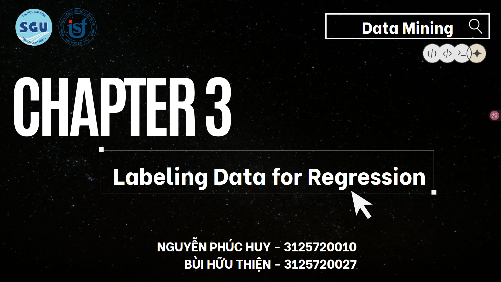

# Loan Interest Rate Regression

---
## Project Overview

Seminar assignment for the Data Mining course: Exploring methods for labeling regression datasets through the study of the document `Data Labeling in Machine Learning with Python`.

---

## Business Problem
Financial institutions need to determine suitable interest rates for loan applicants while balancing profitability and credit risk.

---

## Project Goal
1. Understand and apply data labeling techniques for regression tasks.
2. Address a real-world business problem using data mining techniques.
3. Evaluate and compare different methods and algorithms based on Mean Absolute Error (MAE).

---

## Dataset

The dataset is not included in this repository due to its large size.

Dataset:
https://www.kaggle.com/datasets/adarshsng/lending-club-loan-data-csv?select=loan.csv

After downloading, place the dataset in the following directory:

```text
data/
```
---

## Project Structure

```text
loan-interest-rate-labeling/
│
├── data/
|
│
├── notebooks/
│   ├── eda_and_preprocessing.ipynb
│   ├── using_summary_statistics.ipynb
│   ├── using_data_augmentation.ipynb
|   └── k_means_clustering.ipynb
│
│
├── README.md
```

---

## Workflow

1. Exploratory Data Analysis (EDA)
2. Data Preprocessing
3. Train-Test Split
4. Labeling Data Using Summary Statistics
5. Labeling Data Using Data Augmentation
6. Labeling Data Using K-Means Clustering
7. Model Training
8. Model Evaluation (MAE)
9. Results Comparison

---

## Report
📄 [View Slides](https://canva.link/2r3twpwczddvjq4)

### Contents
- Introduction to Data Labeling for Regression
- Business Problem Analysis
- Exploratory Data Analysis (EDA)
- Data Preprocessing Techniques
- Regression Labeling Methods
- Experimental Setup
- Model Evaluation using MAE
- Results and Comparison
- Conclusions and Future Work
### Results Table
| Method                      | MAE   | Compared to Baseline (3.789) |
| --------------------------- | ----- | ---------------------------- |
| Summary Statistics + Euclid | 7.21  | ~90% worse                   |
| K-Means Labeling            | 3.91  | ~3% worse                    |
| Baseline (Mean Prediction)  | 3.789 | N/A                          |
| Data Augmentation + RF      | 3.39  | ~11% better                  |
| Pseudo-Labeling RF          | 3.35  | ~12% better                  |
| Self-Training               | 3.35  | ~12% better                  |
---