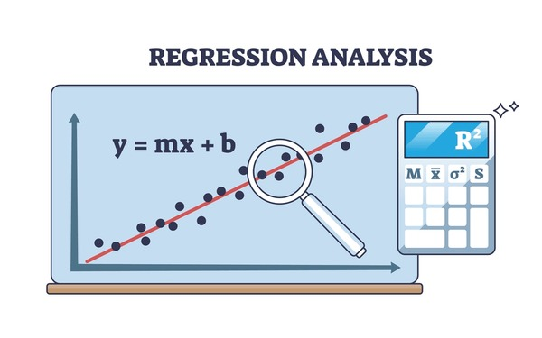

# Loan Interest Rate Regression

---
## Project Overview

Bài tập seminar môn Data Mining. Học cách gán nhãn dựa cho dữ liệu hồi quy thông qua tìm hiểu tài liệu Data Labeling in Machine Learning with Python.

---

## Business Problem
Financial institutions need to determine suitable interest rates for loan applicants while balancing profitability and credit risk.

---

## Project Goal
```text
-Học được cách gán nhãn cho dữ liệu kiểu hồi quy.
-Giải quyết bài toán thực tế trong doanh nghiệp.
-So sánh các phương pháp & thuật toán thông qua sai số trung bình tuyệt đối (MAE)
-Tiếp tục phát triển lên xây dựng các mô hình dự đoán.
```
---

## Dataset
The dataset is not included in this repository due to its large size.

Dataset link:
https://www.kaggle.com/datasets/adarshsng/lending-club-loan-data-csv?select=loan.csv


Place the dataset in:
data/

---

## Project Structure

```text
loan-interest-rate-prediction/
│
├── data/
|
│
├── notebooks/
│   ├── eda_and_preprocessing.ipynb
│   ├── using_summary_statistics.ipynb
│   ├── using_data_augmentation.ipynb
|   └── k_means_clustering.ipynb
│
│
├── README.md
```

---

## Workflow
1. Exploratory Data Analysis (EDA)
2. Data Preprocessing
3. Data Splitting
4. Labeling Data for Regression
...

---